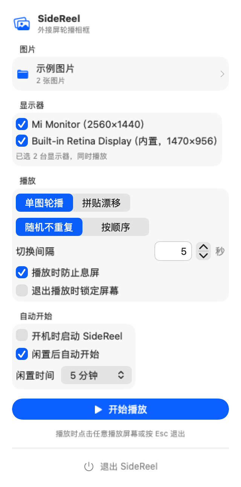

# SideReel

把指定显示器变成相框的 macOS 菜单栏小工具。在外接屏上全屏轮播你指定的图片文件夹，内置屏保持可用（随时 Touch ID），点一下播放屏幕即可退出。



## 特性

- **指定显示器**播放，默认第一个外接显示器
- 两种播放模式：**单图轮播**（切换间隔 1–3600 秒，带淡入过渡）或**拼贴漂移**（多张照片同屏缓慢漂移、定时换新，漂移速度与同屏照片数 4–30 可调）
- **随机不重复**（一轮播完才重复）或**按顺序**轮播
- **闲置自动开始**（1/2/5/10/15/30/60 分钟）或手动开始
- **生效时间段**（每天一个时间段，默认全天；时段外无法开始播放，播放中到点自动停止）
- **开机时启动**（注册为系统登录项，可在「系统设置 › 通用 › 登录项」中管理）
- **点击该屏幕任意处或按 Esc 退出**
- 可选**退出播放时锁定屏幕**（进入系统登录界面，仅所选显示器覆盖全部屏幕时可开启）
- 用无边框窗口实现，默认**不触发系统锁屏**，播放时可选阻止显示器休眠
- 支持 JPEG / PNG / HEIC / TIFF / GIF 等常见格式

## 系统要求

- macOS 26 或更高
- Apple Silicon（arm64）

## 安装

1. 从 [Releases](https://github.com/souvenirding/SideReel/releases) 下载 `SideReel-*-macOS-arm64.zip` 并解压。
2. 将 `SideReel.app` 拖入「应用程序」。
3. 应用为 ad-hoc 签名（未公证），首次启动请**右键 → 打开**以绕过 Gatekeeper。

## 使用

点击菜单栏的相框图标 → 选择图片文件夹与显示器 → 选择播放模式（单图轮播 / 拼贴漂移）与顺序 → 「开始播放」，或开启「闲置后自动开始」。

- 退出播放：点击播放屏幕任意位置，或按 `Esc`。
- 退出应用：面板底部「退出 SideReel」，或按 `⌘Q`。

> 默认不锁屏；开启「退出播放时锁定屏幕」后，退出播放会进入系统登录界面（需账户设有密码，Touch ID 可解锁）。macOS 自身的屏幕保护 / 锁定设置仍独立生效。

> 「开机时启动」的登录项跟随 app 所在位置；把 app 移到别的文件夹后需重新勾选一次。

## 从源码构建

需要 Xcode（可用 `DEVELOPER_DIR` 指定）：

```sh
./Scripts/build-app.sh   # 产物在 build/SideReel.app
```

运行引擎自测：

```sh
swift build -c release
./.build/release/SlideshowSelfTest <图片文件夹> [秒数] [显示器名]
```

## 许可证

[MIT](LICENSE)